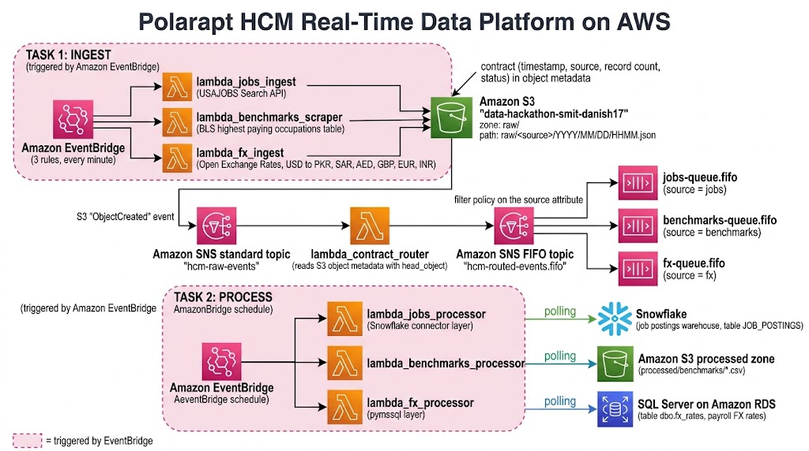
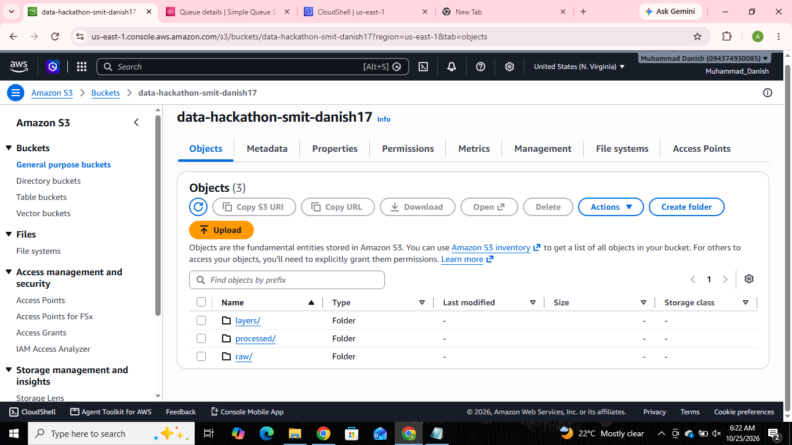
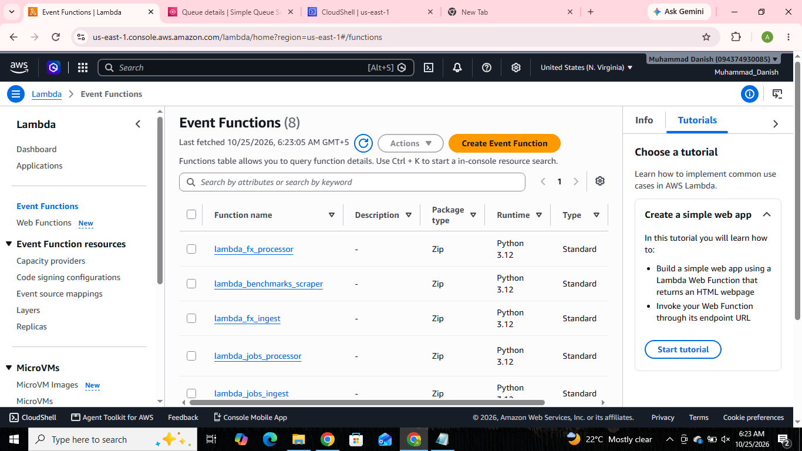
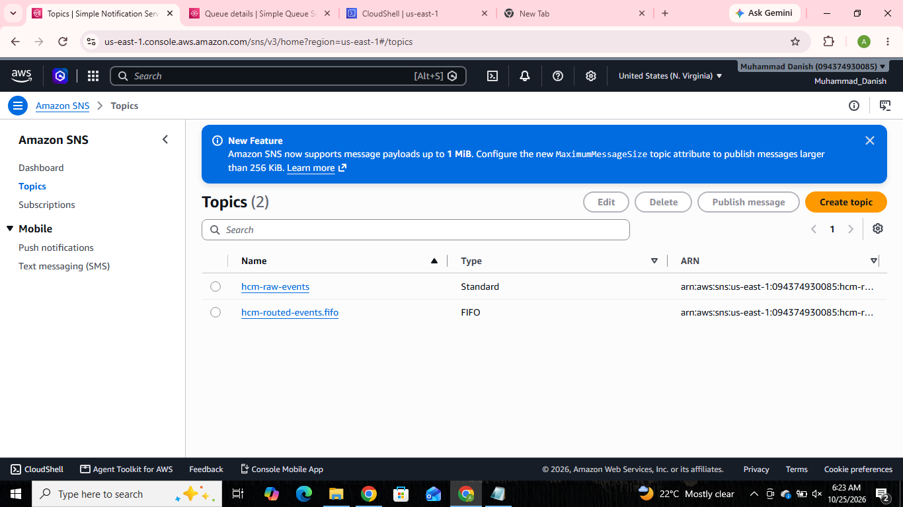
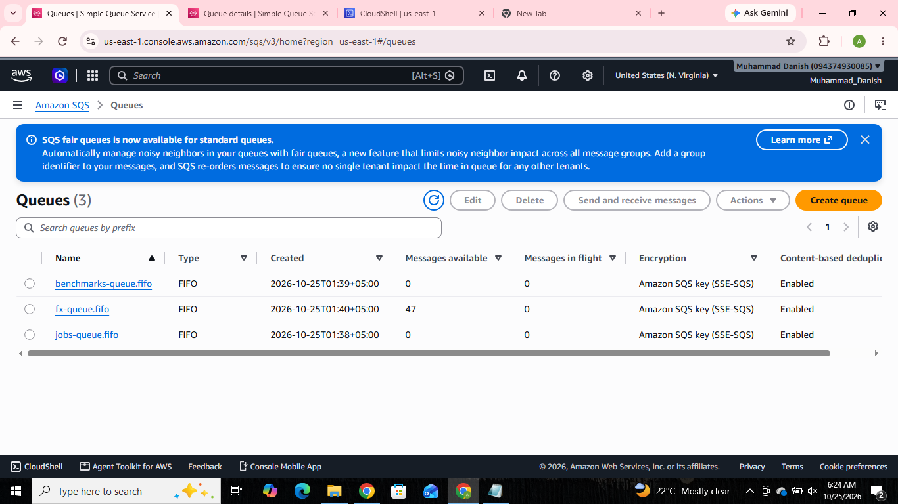
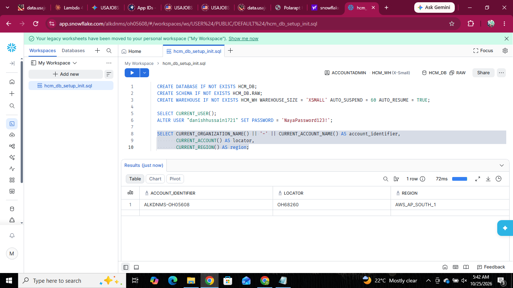

# Polarapt HCM Real-Time Data Platform on AWS

A serverless, event-driven data pipeline built for the Data Engineering Hackathon (Polarapt HCM). It collects three public HR data feeds every minute, stores them in Amazon S3, routes each feed by its source, and loads it into its own destination.

**Author:** Muhammad Danish
**Region:** us-east-1 (N. Virginia)
**Bucket:** `data-hackathon-smit-danish17`

---

## Architecture



**Flow in one line:**
three sources → Lambda (every minute) → S3 `raw/` → SNS (standard) → router Lambda → SNS FIFO topic → three SQS FIFO queues → three processors → three destinations.

---

## Data sources

| Source | What it gives | How it is read | Ingest Lambda | Destination |
| --- | --- | --- | --- | --- |
| USAJOBS | US federal job postings (up to 500 per call): title, organization, location, salary, open and close dates | Search API with an API key | `lambda_jobs_ingest` | Snowflake |
| BLS Highest Paying Occupations | Top 10 occupations by median annual pay | Web page scraping | `lambda_benchmarks_scraper` | S3 processed zone (CSV) |
| Open Exchange Rates | USD rates against PKR, SAR, AED, GBP, EUR, INR | API with an App ID | `lambda_fx_ingest` | SQL Server on Amazon RDS |

---

## How it works

### Task 1: Data acquisition

- Three Amazon EventBridge rules start the three ingest Lambdas every minute.
- Each Lambda saves its result in S3 at `raw/<source>/YYYY/MM/DD/HHMM.json`.
- Every file carries a **contract**: timestamp, source name, record count, and response status. The contract is stored twice: inside the JSON file, and as S3 object metadata.

Example file path: `raw/fx/2026/10/25/0545.json`

### Task 2: Routing and processing

1. S3 sends an `ObjectCreated` event to the standard SNS topic `hcm-raw-events`.
2. The router Lambda `lambda_contract_router` reads the file metadata with `head_object` (no file download).
3. The router republishes to the FIFO topic `hcm-routed-events.fifo` with a `source` message attribute. The message group is the source, and the deduplication ID is the file key.
4. Filter policies on the FIFO topic deliver each message to the matching queue:
   - `source = jobs` → `jobs-queue.fifo`
   - `source = benchmarks` → `benchmarks-queue.fifo`
   - `source = fx` → `fx-queue.fifo`
5. An EventBridge schedule starts each processor. Each processor reads its queue, loads the file from S3, does its work, and deletes the message.

| Queue | Processor | What it does | Destination |
| --- | --- | --- | --- |
| `jobs-queue.fifo` | `lambda_jobs_processor` (Snowflake connector layer) | Flattens each posting into one row | Snowflake `HCM_DB.RAW.JOB_POSTINGS` |
| `benchmarks-queue.fifo` | `lambda_benchmarks_processor` | Ranks occupations by median pay and writes a CSV | S3 `processed/benchmarks/*.csv` |
| `fx-queue.fifo` | `lambda_fx_processor` (`pymssql` layer) | Creates the database and table if missing, inserts one row per currency | SQL Server on RDS, table `dbo.fx_rates` |

The FX and Jobs processors check the source file name before loading, so the same file is never loaded twice.

---

## AWS services and tools

| Service or tool | Use |
| --- | --- |
| AWS Lambda (Python 3.12) | Ingest, router, and processor code |
| Amazon EventBridge | Schedules (every minute) |
| Amazon S3 | `raw/`, `processed/`, and `layers/` folders |
| Amazon SNS | Standard topic `hcm-raw-events` and FIFO topic `hcm-routed-events.fifo` |
| Amazon SQS (FIFO) | `jobs-queue.fifo`, `benchmarks-queue.fifo`, `fx-queue.fifo` (content-based deduplication on) |
| Amazon RDS (SQL Server Express) | FX rates table |
| Snowflake | Job postings warehouse (`HCM_DB`, warehouse `HCM_WH`) |
| AWS IAM | Execution role `hcm-lambda-role` |
| Lambda layers | `pymssql-layer`, `snowflake-layer` (built in AWS CloudShell) |
| CloudWatch Logs | Run logs and errors |

---

## Lambda functions

| Function | Role |
| --- | --- |
| `lambda_jobs_ingest` | Fetches job postings from USAJOBS |
| `lambda_benchmarks_scraper` | Scrapes the BLS pay table (with a fallback snapshot) |
| `lambda_fx_ingest` | Fetches exchange rates |
| `lambda_contract_router` | Reads metadata and republishes to the FIFO topic |
| `lambda_jobs_processor` | Loads job postings into Snowflake |
| `lambda_benchmarks_processor` | Writes the processed CSV to S3 |
| `lambda_fx_processor` | Inserts FX rates into SQL Server |

---

## Configuration

Secrets are set as Lambda environment variables. Never commit real values to Git.

| Function | Environment variables |
| --- | --- |
| `lambda_fx_ingest` | `BUCKET`, `OXR_APP_ID` |
| `lambda_benchmarks_scraper` | `BUCKET` |
| `lambda_jobs_ingest` | `BUCKET`, `USAJOBS_API_KEY`, `USAJOBS_EMAIL` |
| `lambda_contract_router` | `FIFO_TOPIC_ARN` |
| `lambda_benchmarks_processor` | `QUEUE_URL` |
| `lambda_fx_processor` | `QUEUE_URL`, `DB_HOST`, `DB_USER`, `DB_PASSWORD`, `DB_NAME` |
| `lambda_jobs_processor` | `QUEUE_URL`, `SF_ACCOUNT`, `SF_USER`, `SF_PASSWORD`, `SF_WAREHOUSE`, `SF_DATABASE`, `SF_SCHEMA` |

---

## Setup order

1. Get the API keys: Open Exchange Rates App ID and USAJOBS API key (BLS needs none).
2. Create the S3 bucket and the IAM role `hcm-lambda-role`.
3. Create the three ingest Lambdas and their EventBridge rules.
4. Create the three SQS FIFO queues and the two SNS topics.
5. Add filter policies to the FIFO topic subscriptions (`source = jobs / benchmarks / fx`).
6. Allow S3 to publish to the standard SNS topic, then add the S3 event notification (prefix `raw/`).
7. Create the router Lambda and subscribe it to `hcm-raw-events`.
8. Create the Lambda layers (`pymssql-layer`, `snowflake-layer`) in CloudShell.
9. Create the three processor Lambdas and their EventBridge schedules.
10. Create the RDS SQL Server instance and the Snowflake database and warehouse.

---

## Results







- S3 bucket has the `raw/`, `processed/`, and `layers/` folders.
- Two SNS topics (one standard, one FIFO) and three SQS FIFO queues are in place.
- The Snowflake table `HCM_DB.RAW.JOB_POSTINGS` holds **500 rows** from one USAJOBS file.

To check Snowflake yourself:

```sql
SELECT COUNT(*) AS total_rows FROM HCM_DB.RAW.JOB_POSTINGS;

SELECT SOURCE_FILE, COUNT(*) AS rows_in_file, MAX(INGESTED_AT) AS loaded_at
FROM HCM_DB.RAW.JOB_POSTINGS
GROUP BY SOURCE_FILE
ORDER BY loaded_at DESC;
```

To check SQL Server:

```sql
SELECT * FROM dbo.fx_rates ORDER BY id DESC;
```

---

## Problems faced and fixes

| Problem | Fix |
| --- | --- |
| BLS returned HTTP 403 to requests from AWS | The scraper tries a live fetch first. If it fails, it saves a snapshot of the top 10 occupations. The contract records `live_fetch` and `response_status`. |
| S3 can only publish to a standard SNS topic | A router Lambda reads the metadata and republishes to the FIFO topic with a `source` attribute. |
| Open Exchange Rates free plan allows 1,000 requests per month | The FX rule is enabled only for tests and demos. |
| `pymssql` and the Snowflake connector are not in Lambda | Built them as layers in CloudShell. The Snowflake layer was uploaded through S3 because of its size. |
| Snowflake login returned a 404 error | The account locator alone was wrong. Used the full `organization-account` identifier. |

---

## Differences from the brief

- The brief asks for a Glue job for the Jobs source. This project uses a Lambda function (`lambda_jobs_processor`) with a Snowflake layer, because the account is on a free plan. The logic is the same.
- Processed files go to a `processed/` folder in the same bucket instead of a separate bucket.
- The BLS fallback snapshot is an addition for the 403 problem.

---

## Cost and safety notes

- Ingest rules run every minute. Disable them after a demo, especially the FX rule (API limit) and the Jobs rule (large files).
- Stop or delete the RDS instance when finished.
- The Snowflake warehouse suspends itself after 60 seconds.
- For this hackathon, the IAM role has broad access and the SQL Server port 1433 is open to the internet. This is not suitable for production.

## Future improvements

- Give each role only the access it needs, and place the Lambdas and RDS in a private network.
- Add a dead-letter queue to every SQS queue.
- Move passwords and API keys to AWS Secrets Manager.
- Add CloudWatch alarms for failed Lambda runs and growing queues.
